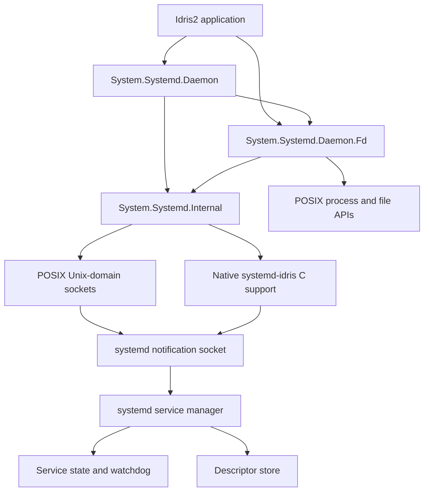
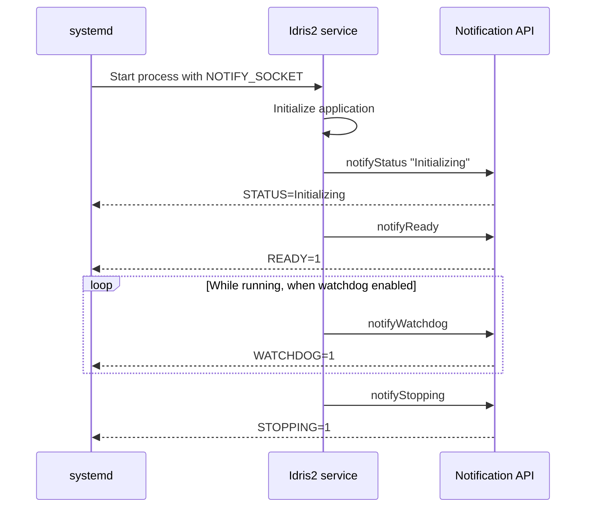
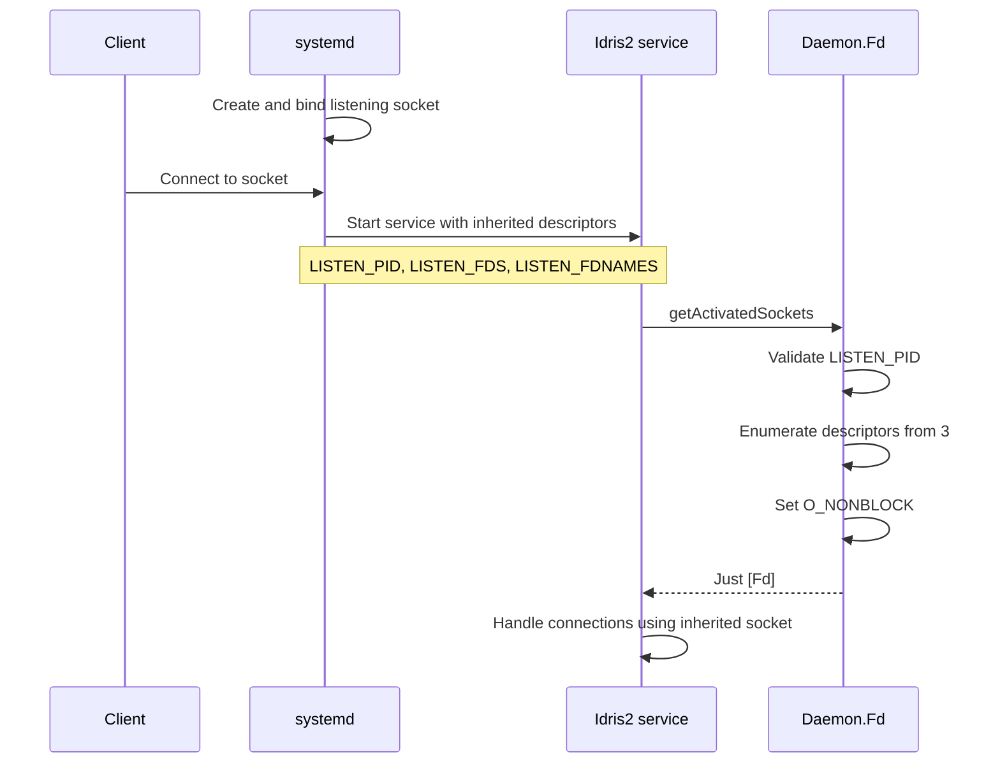
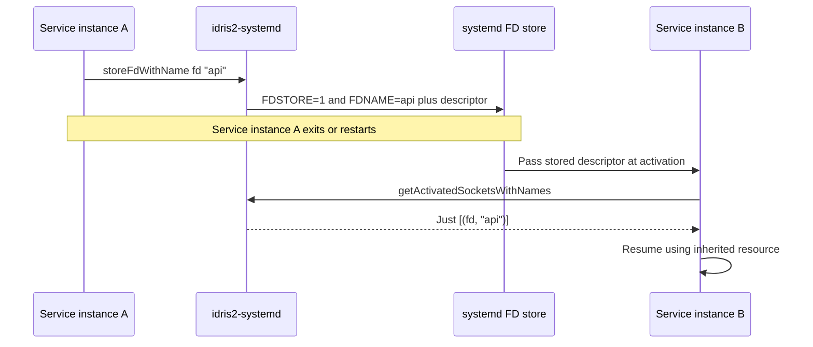
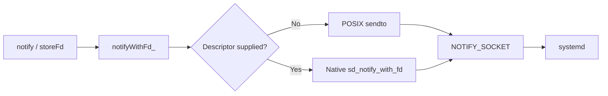

# Idris2 bindings for systemd service notification and socket activation

This library provides an Idris2 interface for integrating applications with
[systemd](https://systemd.io/), including service readiness notifications,
watchdog heartbeats, status reporting, socket activation, and file descriptor
storage. It combines a convenient daemon-facing API with lower-level POSIX file
descriptor operations, allowing applications to cooperate with the service
manager without invoking `systemctl` or implementing the notification protocol
themselves.

> [!NOTE]
> The implementation uses
> [idris2-posix](https://github.com/stefan-hoeck/idris2-posix) and
> [idris2-elin](https://github.com/stefan-hoeck/idris2-elin), together with a
> small native C support library. Familiarity with POSIX sockets and file
> descriptors is useful when working with socket activation and descriptor
> storage.

## Building

Running `make build` builds the library (this can also be done via `pack build`).

## Installation

```sh
pack install systemd
```

For a manual installation, build the package and its native support library
first, then install using the package manager or Idris2 setup appropriate to
your environment. The package's `preinstall` hook runs `make -C support install`
to install the native support artifact into the repository's `lib` directory.

## Features

- **Service lifecycle notifications**
  - Signal readiness with `READY=1`
  - Report configuration reloads with `RELOADING=1`
  - Signal shutdown with `STOPPING=1`
  - Update the service's human-readable `STATUS=` message
  - Report `MAINPID=`, `ERRNO=`, and `BUSERROR=` values
- **Watchdog integration**
  - Send `WATCHDOG=1` heartbeats from an Idris2 service
- **Socket activation**
  - Retrieve file descriptors inherited from systemd
  - Validate `LISTEN_PID` against the current process
  - Read `LISTEN_FDS` and enumerate descriptors beginning at file descriptor `3`
  - Retrieve descriptor names from `LISTEN_FDNAMES`
  - Set inherited descriptors to nonblocking mode
- **File descriptor storage**
  - Send descriptors to systemd using `FDSTORE=1`
  - Associate stored descriptors with names using `FDNAME=`
  - Work with either POSIX `Fd` values or the library's socket-oriented wrappers
- **Explicit notification environment handling**
  - Send custom notification strings
  - Optionally clear systemd-related environment variables after a notification
  - Represent unavailable notification or activation contexts with `Maybe`

## Why use this library?

A service managed by systemd can do more than start and stop as a conventional
process. It can explicitly tell the service manager when initialization has
completed, publish its current status, send periodic watchdog heartbeats, and
accept listening sockets created before the application starts.

Without a dedicated Idris2 interface, applications would need to reproduce
systemd's notification protocol, interpret inherited environment variables, and
handle file descriptor passing themselves. This library places those operations
behind a small set of Idris2 functions while preserving access to raw
descriptors when necessary.

The distinction is especially useful for long-running services: **process
startup and socket ownership can be coordinated by systemd, while application
logic remains in Idris2.**

## Architecture

At a high level, the library separates service-level operations,
descriptor-level operations, and the underlying POSIX/native notification
implementation.



The high-level `System.Systemd.Daemon` module exposes notification helpers and
socket-oriented wrappers. `System.Systemd.Daemon.Fd` handles raw descriptors and
socket activation metadata. `System.Systemd.Internal` implements the
notification transport, including the native C call used when sending a
descriptor.

### Public modules

| Module                     | Responsibility                                |
| -------------------------- | --------------------------------------------- |
| `System.Systemd.Daemon`    | Service lifecycle, status and watchdog        |
| `System.Systemd.Daemon`    | Socket-oriented activation and storage        |
| `System.Systemd.Daemon.Fd` | Raw `Fd` notification, storage and activation |
| `System.Systemd.Internal`  | Notification transport and native FFI         |


## Service notifications

systemd exposes a notification socket through the `NOTIFY_SOCKET` environment
variable. An application sends newline-separated `KEY=VALUE` messages to that
socket to report service events.



### Notification API

Import `System.Systemd.Daemon`:

```idris
import System.Systemd.Daemon
```

| Function          | Type                              | Notification         |
| ----------------- | --------------------------------- | -------------------- |
| `notify`          | `Bool -> String -> IO (Maybe ())` | Arbitrary message    |
| `notifyReady`     | `IO (Maybe ())`                   | `READY=1`            |
| `notifyWatchdog`  | `IO (Maybe ())`                   | `WATCHDOG=1`         |
| `notifyReloading` | `IO (Maybe ())`                   | `RELOADING=1`        |
| `notifyStopping`  | `IO (Maybe ())`                   | `STOPPING=1`         |
| `notifyPID`       | `Int -> IO (Maybe ())`            | `MAINPID=<pid>`      |
| `notifyStatus`    | `String -> IO (Maybe ())`         | `STATUS=<message>`   |
| `notifyErrno`     | `Errno -> IO (Maybe ())`          | `ERRNO=<number>`     |
| `notifyBusError`  | `String -> IO (Maybe ())`         | `BUSERROR=<message>` |

For example:

```idris
import System.Systemd.Daemon

main : IO ()
main = do
  ignore $ notifyStatus "Starting application"
  -- Initialize application resources here.
  ignore notifyReady
  -- Run the application's main loop here.
  ignore notifyStopping
```

`notify` accepts a `Bool` indicating whether systemd-related environment
variables should be unset after the attempt. The convenience functions pass
`False`, leaving the environment available for subsequent notifications.

> [!NOTE]
> The implementation returns `Maybe ()` rather than a delivery acknowledgment
> from systemd. In particular, `Just ()` should not be interpreted as proof
> that the service manager accepted or acted on the message. The current
> internal implementation also maps some missing or invalid notification
> contexts to a no-op result; callers should not rely on `Nothing` as a
> complete diagnostic of whether systemd received a notification.

### Configuring a notifying service

A typical service unit using readiness notification looks like this:

```ini
[Unit]
Description=Example Idris2 service

[Service]
Type=notify
ExecStart=/usr/local/bin/my-idris-service
NotifyAccess=main
Restart=on-failure

[Install]
WantedBy=multi-user.target
```

With `Type=notify`, systemd waits for `READY=1` before considering the service's
startup complete. The application should send readiness only after it can
actually serve requests.

### Watchdog heartbeats

`notifyWatchdog` sends the message `WATCHDOG=1`. The application must arrange to
call it periodically when watchdog supervision is enabled; this library does
**not** start a background heartbeat worker or derive a heartbeat interval
automatically.

```ini
[Service]
Type=notify
ExecStart=/usr/local/bin/my-idris-service
WatchdogSec=30s
NotifyAccess=main
```

For this example, a healthy service should send heartbeats at an interval
comfortably shorter than the configured 30-second deadline. Heartbeats must
reflect genuine application health rather than merely the continued execution of
an unrelated timer.

## Socket activation

With socket activation, systemd creates and binds listening sockets before
starting the service. The service then inherits the open descriptors and can
begin handling connections without creating or binding those sockets itself.



### Activation environment

| Variable         | Meaning                                                      |
| ---------------- | ------------------------------------------------------------ |
| `LISTEN_PID`     | PID of the process expected to consume the descriptors       |
| `LISTEN_FDS`     | Number of inherited descriptors, beginning at descriptor `3` |
| `LISTEN_FDNAMES` | Colon-separated descriptor names, when supplied              |

The implementation checks that `LISTEN_PID` matches the current process,
constructs the descriptor sequence from `3` through `3 + LISTEN_FDS - 1`, and
applies `O_NONBLOCK` to the descriptors. If the activation environment is absent
or invalid, the API may return `Nothing`.

### Raw file descriptor API

The lower-level interface is appropriate when the application needs to inspect
socket families, handle descriptors of different kinds, or integrate with its
own POSIX socket abstractions.

```idris
import System.Systemd.Daemon.Fd

getActivatedSockets : IO (Maybe (List Fd))
getActivatedSocketsWithNames : IO (Maybe (List (Fd, String)))
```

### Socket-oriented API

The high-level module also provides:

```idris
import System.Systemd.Daemon

getActivatedSockets : IO (Maybe (List (Socket AF_UNIX)))
getActivatedSocketsWithNames : IO (Maybe (List (Socket AF_UNIX, String)))
```

These wrappers convert inherited descriptor values into `Socket AF_UNIX` values.
**They do not independently verify that each inherited descriptor is an AF_UNIX
socket.** For TCP, IPv6, mixed socket families, or non-socket descriptors,
prefer the raw `Fd` API and perform the appropriate validation before
interpreting the descriptor.

### Example socket unit

```ini
[Unit]
Description=Example Idris2 socket

[Socket]
ListenStream=/run/my-idris-service.sock
FileDescriptorName=api

[Install]
WantedBy=sockets.target
```

A corresponding service might contain:

```ini
[Unit]
Description=Example Idris2 socket-activated service

[Service]
ExecStart=/usr/local/bin/my-idris-service
```

The socket unit can activate a matching service unit, such as
`my-idris-service.socket` activating `my-idris-service.service`. The service
should consume the inherited descriptor instead of binding
`/run/my-idris-service.sock` again.

## File descriptor storage

systemd can retain descriptors supplied by a service and pass them back during a
subsequent activation, provided the service unit and manager support and
configure the descriptor store. This can help preserve listening sockets or
other resources across process restarts.



### Descriptor storage API

The raw-descriptor API is provided by `System.Systemd.Daemon.Fd`:

| Function          | Type                                    |
| ----------------- | --------------------------------------- |
| `notifyWithFd`    | `Bool -> String -> Fd -> IO (Maybe ())` |
| `storeFd`         | `Fd -> IO (Maybe ())`                   |
| `storeFdWithName` | `Fd -> String -> IO (Maybe ())`         |

The socket-oriented API is provided by `System.Systemd.Daemon`:

| Function          | Type                                                |
| ----------------- | --------------------------------------------------- |
| `notifyWithFD`    | `Bool -> String -> Socket AF_UNIX -> IO (Maybe ())` |
| `storeFd`         | `Socket AF_UNIX -> IO (Maybe ())`                   |
| `storeFdWithName` | `Socket AF_UNIX -> String -> IO (Maybe ())`         |

The `storeFd` functions construct `FDSTORE=1`; `storeFdWithName` additionally
sends `FDNAME=<name>`. `notifyWithFd` and `notifyWithFD` accept arbitrary
notification strings, so callers must include `FDSTORE=1` themselves if they
want systemd to store the descriptor.

A service unit must configure descriptor storage, for example:

```ini
[Service]
Type=notify
ExecStart=/usr/local/bin/my-idris-service
NotifyAccess=main
FileDescriptorStoreMax=16
Restart=on-failure
```

> [!NOTE]
> Storing a descriptor is not sufficient by itself to guarantee a
> zero-downtime restart. Correct behavior depends on service-manager
> configuration, descriptor lifetime, activation behavior, and the
> application's ability to resume safely from inherited resources.

## Notification transport

The library's internal notification path reads `NOTIFY_SOCKET`, creates an
`AF_UNIX` datagram socket, and sends the notification message to systemd. For
descriptor-bearing messages, it calls the native `sd_notify_with_fd` support
function through Idris2's C FFI.



`NOTIFY_SOCKET` can refer to a filesystem Unix-domain socket or an
abstract-namespace socket (indicated by a leading `@`). The native support layer
is built as `systemd-idris` and linked through the foreign declaration in
`System.Systemd.Internal`.

The optional environment-unset flag clears `NOTIFY_SOCKET`, `LISTEN_PID`,
`LISTEN_FDS`, and `LISTEN_FDNAMES` after a notification attempt. This is useful
when notification capability should not be reused, but it also means later calls
that depend on these variables may no longer work.

## Operational considerations

- **Use the correct systemd unit type.** Readiness notifications require a
  unit configured to accept them, commonly `Type=notify` with an appropriate
  `NotifyAccess=` policy.
- **Treat inherited descriptors as resources with ownership.** Do not close
  them before the application has finished using them, and do not assume their
  socket family from their integer values.
- **Validate activation metadata.** The raw activation API uses `LISTEN_PID`,
  `LISTEN_FDS`, and optionally `LISTEN_FDNAMES`; named activation additionally
  requires the number of names to match the number of descriptors.
- **Understand nonblocking behavior.** The current raw activation
  implementation sets `O_NONBLOCK` on inherited descriptors, which affects
  subsequent reads, writes, and accepts.
- **Handle absent supervision.** Applications launched outside a systemd
  notification or socket-activation context should account for `Maybe`
  results.
- **Keep watchdog health meaningful.** Only send heartbeats when the
  application is actually healthy, and schedule them relative to the
  configured watchdog interval.
- **Check error handling at the boundary.** Some current implementation paths
  print errors and return `Nothing`, while other internal paths may treat
  unavailable notification state as a no-op. The API is not a complete
  structured diagnostic interface.

## Testing

The repository includes a `test` directory and references `test/test.ipkg` from
`pack.toml`. To run the configured test package with pack:

```sh
pack test
```

Integration tests involving readiness, watchdogs, inherited sockets, or
descriptor storage should be executed under a suitable systemd environment. A
standalone invocation will not automatically provide `NOTIFY_SOCKET` or the
`LISTEN_*` activation variables.

## References

- [systemd service notification protocol (`sd_notify`)][link-1]
- [systemd socket activation (`sd_listen_fds`)][link-2]
- [systemd socket units (`systemd.socket`)][link-3]
- [systemd service units (`systemd.service`)][link-4]
- [systemd file descriptor store][link-5]

[link-1]: https://www.freedesktop.org/software/systemd/man/sd_notify.html
[link-2]: https://www.freedesktop.org/software/systemd/man/sd_listen_fds.html
[link-3]: https://www.freedesktop.org/software/systemd/man/systemd.socket.html
[link-4]: https://www.freedesktop.org/software/systemd/man/systemd.service.html
[link-5]: https://www.freedesktop.org/software/systemd/man/systemd.service.html
